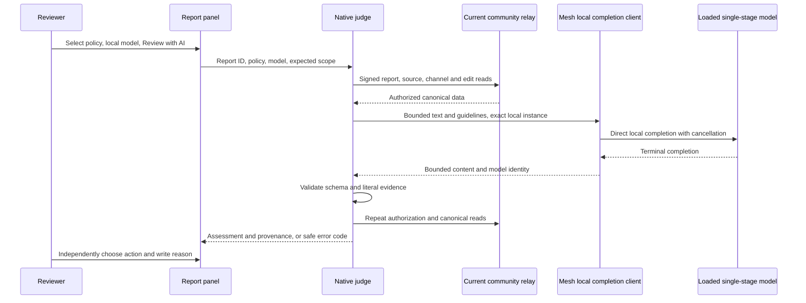

# Community reports and local AI advice

Community owners and admins can review reports in **Settings → Communities →
Reports**. Every moderation decision remains a human action. The optional AI
preview compares one eligible message with a chosen guideline template and
returns advice for that reviewer.

The preview is off by default. MeshLLM is the built-in provider and
`buzz-moderation-guidelines/v1` is the suggested template. Neither installs or
starts a model, adopts a community policy, or scans messages in the background.
No model is qualified as a recommended moderation default by this change.

## Human review

The queue works in builds without MeshLLM. Owners and admins can filter and
refresh up to 500 reports, inspect the canonical target, and enter a
reporter-visible reason. Community moderation does not grant access to the
deployment staff console or bypass private-channel read permissions.

Before each action or decision retry, the app rechecks authority, the open
report, its target, channel and edits against the inspected state. A change
requires **Refresh target for inspection** before proceeding. Observed source
edits or deletions clear advice and cancel pending review; unobserved remote
changes are checked again before the action. A missing or inaccessible channel
still permits authorized dismissal, escalation and captured decision recovery,
but does not permit new enforcement. Other read failures block the action.

Dismiss and escalate record a decision. Delete, kick, ban and timeout first
perform the selected enforcement and then record the report decision. Kind
`9044` records a decision; it does not enforce a penalty. If enforcement
succeeds but recording fails, **Retry decision only** preserves the captured
choice and reason. An uncertain enforcement outcome stays locked for manual
verification. Report navigation and leaving Settings preserve this recovery
state within the community session.

## Request path

The native entry points are `moderation_judge_status`,
`review_moderation_report`, and `cancel_moderation_review`. The renderer does
not submit source text or report notes to the review command. Native code
captures the relay, signer and workspace generation, releases application
locks, and reads the canonical data with those captured credentials.

Each validation pass reads the authenticated community report queue, the kind
`9` target, kind `39000` channel metadata, and kind `40003` edits. HTTP redirects
are refused and response bodies are bounded. The target must be an open,
non-illegal event report in an explicitly open stream or forum channel. Private
and DM channels, system channels, unsupported kinds, attachments, edited or
missing messages, and blob or pubkey reports are unavailable to AI review.
Normal human review remains available subject to its existing permissions.

The inference projection contains the message text, selected rule text and
fixed classification instructions. It excludes the report category, note,
reporter identity, author profile, channel name and unrelated messages. The
single shared guideline resource is
[`defaultGuidelines.json`](../desktop/src/shared/moderation/defaultGuidelines.json).
Review-specific rule edits retain the six rule IDs and remain in memory.

## Local execution and limits

The adapter requires the Mesh SDK's private local-completion capability. It
selects a loaded local instance and bypasses general OpenAI ingress, remote
routing, split workers, committees, plugins, guardrail and compaction services,
and request-content capture. A concrete model name alone would not provide
these guarantees. Missing, ambiguous or ineligible local instances fail closed;
there is no fallback, automatic download, runtime start, or trust change.

| Boundary | Limit |
| --- | --- |
| Source text | 8 KiB UTF-8 |
| Selected rule text | 8 KiB UTF-8 in total |
| Serialized projection | 24 KiB |
| Completion | 512 tokens and 16 KiB |
| Model context | Full prompt plus output budget must fit; no truncation |
| Entire native operation | 60 seconds, including reads and final validation |
| Relay connection | 3 seconds |
| Unresolved reviews | One per application, including cancelled work |
| Automatic retries | None |

Cancellation clears the UI promptly and signals the backend. Admission remains
occupied until the backend has actually stopped. A timeout, closed panel or
replaced runtime cannot release that guard and accumulate hidden work.

Only exact JSON with `verdict`, `matches` and `uncertainty` is accepted.
Verdicts are `needs_review`, `no_match` and `uncertain`. Up to three matches
must use known rule IDs and literal source excerpts of at most 128 characters.
Reasons and uncertainty explanations are limited to 256 characters. Extra
fields, fabricated evidence, tool responses and truncated output are errors.
A parsing or inference error never becomes a clean `no_match` result.

Results carry source and policy digests, policy and prompt versions, request
generation, runtime identity, requested and reported model, SDK version and
timing. These identify the evaluated input; they are not confidence scores.
Assessments are not persisted or published. Observed report, source, channel,
identity, community, authority, policy, model or runtime changes clear them.
Remote changes that have not yet been observed cannot be detected instantly.

## Manual acceptance exercise

Use an isolated community with synthetic messages and an owner, admin and
ordinary member. Keep this PR draft until a human completes the relevant steps.

1. With the preview off, open Reports as owner and admin. Verify that a member
   cannot enter the queue or invoke the native judge. Dismiss one test report
   with your own reason and verify the relay records that decision.
2. Exercise an enforcement failure and a recording failure. Navigate away and
   return. Verify that uncertain enforcement stays locked and successful
   enforcement offers only decision retry. Complete a delayed action on report
   A while viewing B and verify B stays unchanged.
3. Enable **AI advisory report review** in Preview Features. With no eligible local
   runtime, verify that AI availability reports the limitation and the human
   controls still work. A runtime bound to another community must remain
   unavailable for this community.
4. Explicitly start an eligible local model using the normal compute controls.
   Select an open, unchanged text report, choose the suggested policy and the
   model, then select **Review with AI**. Merely opening a report must not
   start inference. Inspect the evidence and provenance; verify the human
   reason is still empty and the report is still open.
5. Cancel a review, navigate between reports, edit the policy and change the
   model. Verify delayed results disappear. Resolve the report from another
   client and refresh the queue; pending or displayed advice must clear.
6. Try an illegal report, private-channel target, edited message and malformed
   completion. Verify AI gives an unavailable/error state without a verdict or
   moderation write. Confirm illegal-report handling still follows the existing
   human and escalation workflow.
7. Edit or delete the selected source from another client. When the change is
   observed, verify advice clears and pending review is cancelled. Attempt an
   action before refreshing; verify it requires fresh inspection and writes
   nothing. Refresh and inspect the changed target. For an inaccessible channel,
   verify authorized dismissal and escalation remain available, and a captured
   decision retry records only the decision without repeating enforcement.
8. Use keyboard navigation and screen-reader labels for the queue, policy/model
   controls, cancel/retry controls and human decision reason.

For repeatable synthetic evaluation and the opt-in native runtime exercise, see
[`moderation-judge-evaluation.md`](moderation-judge-evaluation.md). Development
examples and a runtime smoke test do not satisfy model-quality qualification.
Background scanning, private-content review, shared policy adoption and
automatic enforcement are outside this preview.
